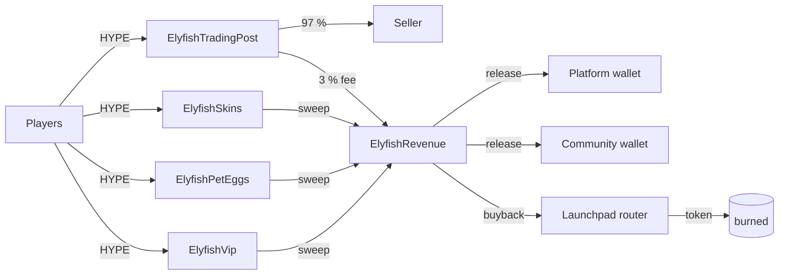

# Elyfish Contracts


The on-chain side of **[Elyfish](https://elyfish.xyz)**, a free 3D fishing game that runs in the browser. Players
pay in HYPE for VIP time, pet eggs and NFT rods and bobbers, and they trade game items with each other. Every payment
is split on chain: part goes to the platform, part to the community, and part buys back the game token and burns it.

- [Contracts](#contracts)
- [How the money flows](#how-the-money-flows)
- [Deployments](#deployments)
- [Test results](#test-results)
- [Getting started](#getting-started)
- [Security model](#security-model)
- [Help and community](#help-and-community)
- [Maintainers](#maintainers)

## Contracts

| Contract | What it does |
|---|---|
| [`ElyfishVip`](src/ElyfishVip.sol) | VIP at $12 per 30 days, paid in HYPE at the HYPE / USD feed rate. Buy for yourself or as a gift. The owner can grant VIP and run Merkle airdrop rounds. |
| [`ElyfishPetEggs`](src/ElyfishPetEggs.sol) | Pet egg packs: 10 eggs for $5. The contract counts each wallet's packs; the game server hatches them once. |
| [`ElyfishSkins`](src/ElyfishSkins.sol) | ERC-721 rods and bobbers: 10,000 tokens, priced in USD per rarity, with ERC-2981 royalties and ERC-4906 metadata refresh. |
| [`ElyfishTradingPost`](src/ElyfishTradingPost.sol) | A player-to-player market. The game server signs each listing (EIP-712). The buyer pays the seller 97 % and the trading post keeps a 3 % fee. |
| [`ElyfishRevenue`](src/ElyfishRevenue.sol) | Owns the four contracts above and splits their revenue. It pays the platform and community wallets, then buys back the game token through the launchpad router and burns it. |
| [`ILaunchRouter`](src/interfaces/ILaunchRouter.sol) | The part of the [Montra](https://montramarkets.xyz) LaunchRouter the buyback uses (Uniswap v4 pool key, exact-input swap). |
| [`testnet/`](src/testnet) | Testnet stand-ins: a HYPE / USD price feed, a launch token and a router with the same ABI as Montra's. |

All contracts use OpenZeppelin `Ownable2Step`, `Pausable` and `ReentrancyGuard` where they hold or move funds.

## How the money flows



| Source | Platform | Community | Buyback and burn |
|---|---|---|---|
| VIP, pet eggs, NFT rods and bobbers | 50 % | 20 % | 30 % |
| Trading post fee (3 % of each sale) | 1 % | — | 2 % |

- **`sweep()` / `sweepOne(target)`:** anyone may call these. They pull the HYPE from the paid contracts, and the contract books it to each side the moment it arrives.
- **`release()`:** anyone may call this. It pays the platform and community wallets what is owed to them.
- **`buyback(amountIn, minOut, deadline)`:** only the owner or a keeper may call this. It needs a minimum output and is capped by `maxBuyback`. It burns exactly what arrived, in the same transaction.
- **`exec(target, data)`:** owner only. It calls a paid contract's own settings (price, grant, airdrop, pause). It refuses their withdraw functions and ownership changes, so HYPE can only leave through the split.

A keeper, a small off-chain service, that calls `sweep`, `release` and `buyback` every 30 minutes.

## Deployments

Elysium testnet (chain id `99801`, RPC `https://testnet-rpc.elysium.kinetiq.xyz`):

| Contract | Address |
|---|---|
| ElyfishRevenue | `0xDAdA65B98227723678D61988A62569469B70C77c` |
| ElyfishVip | `0xe2F4B6F43404A6f1767123e7e5436909E57E9Dd9` |
| ElyfishPetEggs | `0x52281FA594127bc7ebCD8D10bbE3beab3D9eEf02` |
| ElyfishSkins | `0xfF4fB974F27F3B4A40fb624d863DfD193C267D7C` |
| ElyfishTradingPost | `0xD77D4D6eFe78aaeDF5657d07032BCa9379ddC756` |
| MockPriceFeed (HYPE / USD) | `0x9B76127f05e951687dED0853A9589429126b2E7E` |
| MockLaunchToken (mFISH) | `0x80a6Fa43C40480a2Ec8369592Ca3e92EdcF31fe3` |
| MockLaunchRouter | `0x752c035065b94845E7dC78B21ca3551BFE247bfE` |

ElyfishRevenue owns VIP, pet eggs, skins and the trading post. On mainnet (Elysium, chain id `99901`), the mocks are
replaced by a real HYPE / USD feed, the game token from the Montra launchpad and Montra's LaunchRouter.

## Test results

`forge test` with 2,000 runs per fuzz test, and 256 runs × 64 calls per invariant (16,384 random calls each, with
`fail_on_revert = false`).

| Suite | Unit | Fuzz | Invariant | Result |
|---|---|---|---|---|
| ElyfishVip | 31 | 5 | — | ✅ 36 / 36 |
| ElyfishPetEggs | 16 | 2 | — | ✅ 18 / 18 |
| ElyfishSkins | 28 | 7 | — | ✅ 35 / 35 |
| ElyfishTradingPost | 22 | 5 | — | ✅ 27 / 27 |
| ElyfishRevenue | 27 | 3 | — | ✅ 30 / 30 |
| VipInvariant | — | — | 4 | ✅ 4 / 4 |
| Invariant (skins) | — | — | 5 | ✅ 5 / 5 |
| TradingPostInvariant | — | — | 4 | ✅ 4 / 4 |
| RevenueInvariant | — | — | 5 | ✅ 5 / 5 |
| **Total** | **124** | **22** | **18** | **✅ 164 / 164** |

Every one of the 18 invariants held through all its runs, with 0 reverts. Among them:

- **Revenue:** the balance always equals what is booked; each side gets exactly its share; everything bought back is burned and the supply falls by that much; buyback HYPE reaches only the router; the split keeps owning the paid contracts.
- **Trading post:** the balance equals fees plus what sellers are owed; listings move only open → sold or cancelled; the money adds up; no exploit gets through.
- **VIP:** the balance is what was paid minus what was withdrawn; nobody gets VIP more than a year ahead; an airdrop is claimed once, and only by wallets on the list.
- **Skins:** funds and supply add up; token blocks fill from the start; tokens stay what they were minted as; only the owner can do owner things.

`forge coverage` (contracts in `src/`):

| File | Lines | Statements | Branches | Functions |
|---|---|---|---|---|
| ElyfishRevenue.sol | 100.00 % (153/153) | 99.50 % (201/202) | 100.00 % (45/45) | 100.00 % (27/27) |
| ElyfishTradingPost.sol | 100.00 % (66/66) | 100.00 % (101/101) | 100.00 % (17/17) | 100.00 % (13/13) |
| ElyfishVip.sol | 100.00 % (92/92) | 100.00 % (127/127) | 100.00 % (23/23) | 100.00 % (22/22) |
| ElyfishSkins.sol | 100.00 % (117/117) | 99.43 % (173/174) | 96.30 % (26/27) | 100.00 % (28/28) |
| ElyfishPetEggs.sol | 98.36 % (60/61) | 100.00 % (88/88) | 100.00 % (15/15) | 93.33 % (14/15) |
| testnet/MockLaunchRouter.sol | 100.00 % (27/27) | 100.00 % (34/34) | 100.00 % (7/7) | 100.00 % (7/7) |
| testnet/MockLaunchToken.sol | 100.00 % (4/4) | 100.00 % (2/2) | — | 100.00 % (2/2) |
| testnet/MockPriceFeed.sol | 100.00 % (17/17) | 100.00 % (11/11) | 100.00 % (2/2) | 100.00 % (6/6) |
| **Total** | **99.81 %** (536/537) | **99.73 %** (737/739) | **99.26 %** (135/136) | **99.17 %** (119/120) |

## Getting started

You need [Foundry](https://book.getfoundry.sh/getting-started/installation).

```bash
# libraries in lib/ (once, if the folder is empty): forge-std 1.17.0 and OpenZeppelin Contracts 5.4.0
forge install foundry-rs/forge-std@v1.17.0 OpenZeppelin/openzeppelin-contracts@v5.4.0 --no-git
forge build
forge test                                 # unit, fuzz and invariant tests
forge test --match-contract RevenueInvariantTest -vv
forge coverage --report summary --no-match-coverage "(test|script|lib)/"
```

### Deploy

Each script reads `PRIVATE_KEY` and its settings from the environment. Run it against the `elysium_testnet` endpoint in
[`foundry.toml`](foundry.toml). Run once without `--broadcast` to simulate first.

```bash
# NFT skins and a testnet HYPE / USD feed (skins come from skins.json)
forge script script/Deploy.s.sol --rpc-url elysium_testnet --broadcast

# VIP, pet eggs and the trading post (FEED from the step above; SIGNER = the game server's listing signer)
FEED=0x… STALENESS=604800 forge script script/DeployVip.s.sol --rpc-url elysium_testnet --broadcast
FEED=0x… STALENESS=604800 forge script script/DeployPetEggs.s.sol --rpc-url elysium_testnet --broadcast
SIGNER=0x… forge script script/DeployTradingPost.s.sol --rpc-url elysium_testnet --broadcast

# the revenue split; it takes over the four contracts in the same run
MOCK=true PLATFORM=0x… COMMUNITY=0x… VIP=0x… EGGS=0x… SKINS=0x… POST=0x… \
  forge script script/DeployRevenue.s.sol --rpc-url elysium_testnet --broadcast
```

For mainnet, leave out `MOCK`. Instead, pass `TOKEN` (the Montra launch token), `ROUTER` (the LaunchRouter), `HOOK`
and `TICK_SPACING=200`.

Keep private keys out of files and shell history. Pass them only through the environment of the command that needs them.

## Security model

- **Funds leave only through the split.** ElyfishRevenue is the owner of every paid contract, and `exec` refuses their withdraw and ownership functions.
- **Two-step ownership** everywhere (`Ownable2Step`). Handing a contract back (`handOver`) sweeps its HYPE into the split first.
- **Prices come from the HYPE / USD feed.** The contracts reject a stale or non-positive answer, and they cap the USD prices.
- **Buybacks are bounded.** They need a non-zero `minOut`, are capped by `maxBuyback`, and check the balance change instead of trusting the router's return value.
- **Trading post listings are EIP-712 signatures** from the game server, with a price range and an expiry. A seller whose wallet refuses payment can withdraw it later.
- **Payouts never block.** A wallet that refuses HYPE keeps its share booked until a later `release`.

The contracts have not had an external audit yet.

## Help and community

- Game: [elyfish.xyz](https://elyfish.xyz)
- Discord: [discord.gg/GENh6J4g93](https://discord.gg/GENh6J4g93)
- X: [@elyfishxyz](https://x.com/elyfishxyz)
- Source and issues: [github.com/Elyfish-Labs](https://github.com/Elyfish-Labs)
- Foundry documentation: [book.getfoundry.sh](https://book.getfoundry.sh/)

## Maintainers

Built and maintained by **Elyfish Labs**. Questions, bug reports and ideas are welcome on
[Discord](https://discord.gg/GENh6J4g93) or as issues on [GitHub](https://github.com/Elyfish-Labs). Please report
security problems privately on Discord, not in a public issue.
